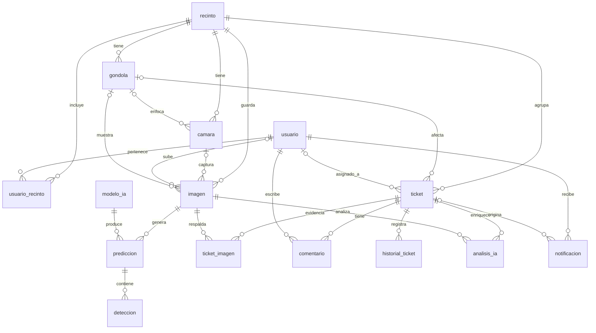

# ReponIA · Plan del proyecto

> Nombre provisional. Detección de vacíos en góndolas de supermercado con YOLO y gestión de tickets de reposición.
> Versión 0.1 · 14-nov-2026

## Índice
1. Objetivo
2. Actores y permisos
3. Flujo principal
4. Arquitectura y stack
5. Conexión de cámaras
6. Modelo de datos
7. Reglas de negocio
8. Cálculo del % de vacío
9. Worker de inferencia
10. API REST propuesta
11. Pantallas (según mockups)
12. Estructura del repositorio
13. Hoja de ruta por fases
14. Supuestos y decisiones abiertas
15. Cómo empezar

---

## 1. Objetivo

Llevar a producción una aplicación web y móvil que:

- Recibe fotos de góndolas desde **cámaras de seguridad** y desde el **celular de los reponedores**.
- Pasa cada foto por un modelo **YOLO** (`best.pt`) que calcula el **% de vacío** de la góndola.
- Si el % supera el **umbral del recinto (5 % por defecto)**, abre un **ticket** (`INC000001`, `INC000002`, …) y alerta al supervisor.
- Opcionalmente, una **API de IA con visión** completa qué producto falta.
- El **supervisor** asigna el ticket a un **reponedor**, que repone y **cierra el ticket con una foto** que se vuelve a verificar con el modelo.

Hay dos recintos al inicio (R01 y R02). Las fotos de cada uno se guardan en su propia carpeta.

## 2. Actores y permisos

| Rol | Qué puede hacer |
|---|---|
| **Administrador** | Gestiona recintos (umbral), góndolas, cámaras (genera su API key), usuarios, versiones del modelo `.pt` y la integración de IA. Ve todo. |
| **Supervisor** | Ve los tickets de sus recintos, los asigna o reasigna a reponedores de su recinto, comenta, cambia estado o cancela. Ve la carga de trabajo de su equipo. |
| **Reponedor** | Ve sus tickets, saca fotos con la app (se predicen y pueden abrir un ticket), completa campos (producto faltante, comentario), cambia a "En progreso" y cierra con foto de verificación. |
| **Sistema** | Las cámaras actúan como "sistema": abren tickets genéricos sin usuario (`creado_por = NULL`). |

## 3. Flujo principal

```
 Cámara IP / NVR ──(RTSP o snapshot)──► Capturador en el recinto ──HTTPS──┐
                                                                          ▼
 App Android (reponedor) ────────────── foto ──────────────────────► API FastAPI
                                                                          │ guarda archivo en recintos/R0X/AAAA/MM/DD/
                                                                          │ INSERT imagen (PENDIENTE)
                                                                          ▼
                                                                 Worker de inferencia (YOLO best.pt)
                                                                          │ INSERT prediccion + deteccion
                                                                          │ SELECT fn_ticket_desde_prediccion(id)
                                                                          ▼
                                                     ¿% vacío > umbral del recinto?
                                                       no → queda en el historial
                                                       sí → ticket nuevo  (o SEGUIMIENTO si ya hay uno abierto)
                                                              │ notificación al supervisor (push + web)
                                                              │ [opcional] API de IA → producto_faltante
                                                              ▼
                                         Supervisor asigna (web) → Reponedor repone (app)
                                                              │ foto de CIERRE → vuelve al worker
                                                              ▼
                                         % bajo el umbral → cierre verificado
```

Estados del ticket: `ABIERTO → ASIGNADO → EN_PROGRESO → CERRADO` (o `CANCELADO`). Al asignar un ticket ABIERTO pasa solo a ASIGNADO (trigger).

Prioridad automática según % de vacío: `< 10` BAJA · `≥ 10` MEDIA · `≥ 20` ALTA · `≥ 40` CRÍTICA. Si una foto de seguimiento empeora el %, la prioridad sube (nunca baja sola).

## 4. Arquitectura y stack

| Componente | Tecnología | Responsabilidad |
|---|---|---|
| Base de datos | PostgreSQL 16 | Fuente de verdad. Esquema en `db/schema.sql` (incluye triggers, función de negocio y vistas). |
| API | Python 3.11+ · FastAPI · SQLAlchemy 2 / psycopg 3 · JWT | Autenticación por rol, ingesta de fotos, CRUD de tickets, administración. |
| Worker de inferencia | Python · Ultralytics YOLO | Carga `best.pt` una vez, procesa imágenes pendientes, guarda predicciones y llama a `fn_ticket_desde_prediccion`. |
| Cola | MVP: la propia tabla `imagen` (`FOR UPDATE SKIP LOCKED`). Luego: Redis + RQ/Celery | Desacoplar la API de la inferencia. |
| Almacenamiento de fotos | MVP: carpeta por recinto (`recintos/R01/...`). Producción: MinIO o S3 con las mismas rutas | Guardar originales e imágenes anotadas. |
| Capturador | Python + ffmpeg (`capturador/capturador.py`) | Corre en cada recinto, toma fotos de las cámaras y las sube a la API. |
| App móvil | Kotlin · Jetpack Compose · CameraX · Retrofit · FCM | App del reponedor. |
| Panel web | Framework a elección (React, Vue, …) consumiendo la API | Supervisor y administrador. |
| IA de producto (opcional) | API de un LLM con visión | Identificar el producto faltante. La API key va en variables de entorno o gestor de secretos, **nunca en la BD**. |
| Despliegue | Docker Compose (api, worker, postgres, [redis], [minio]) | Un solo servidor al inicio. |

## 5. Conexión de cámaras

### Resumen
- A una cámara se le habla por su **dirección IP** (y un puerto), **no por la MAC**.
- La **MAC** sirve para dos cosas: **encontrar** la cámara en la red y **reservarle una IP fija** en el router (reserva DHCP), para que su IP no cambie.
- La imagen se obtiene por uno de dos caminos:
  - **RTSP** (puerto 554), el estándar de video de las cámaras IP. Se abre el stream y se saca 1 cuadro.
  - **Snapshot HTTP**: una URL que devuelve un JPEG. Es más liviano si la cámara lo ofrece.
- **ONVIF** es el estándar que permite descubrir cámaras en la red y pedirles su URL RTSP o de snapshot sin conocer la marca.

### Cómo suele estar armado en un supermercado
- Las cámaras están en la **red local** de la tienda (IPs privadas, p. ej. `192.168.1.x`) y casi siempre conectadas a un **NVR/DVR** (el grabador).
- Lo más simple es **conectarse al NVR**: una sola IP con un canal por cámara, en lugar de cámara por cámara.
- **No exponer cámaras ni el NVR a internet** (nada de abrir puertos en el router).
- En su lugar, cada recinto tiene un **capturador**: un mini PC o Raspberry Pi en la misma red. Lee las cámaras localmente y **sube** las fotos a la API por HTTPS. Solo hace conexiones de salida.
- Alternativa, si el servidor central debe leer las cámaras directamente: una **VPN** (WireGuard/Tailscale) entre el servidor y el recinto.

### Pasos para conectar una cámara
1. **Pedir acceso** al área de TI o a la empresa de seguridad del supermercado. Necesitan:
   - la IP del NVR o de cada cámara;
   - qué canal enfoca cada góndola;
   - un **usuario de solo lectura**;
   - permiso para conectar el capturador a la red.
2. **Encontrar la IP**, con cualquiera de estas opciones:
   - el menú del NVR;
   - la lista de clientes DHCP del router (ahí aparece la MAC; su prefijo identifica la marca);
   - ONVIF Device Manager;
   - `nmap -p 554,80 192.168.1.0/24`.
3. **Fijar la IP**, con una reserva DHCP por MAC en el router o con una IP estática en la cámara.
4. **Obtener la URL RTSP** desde el manual de la marca o desde ONVIF. Ejemplos típicos (verificar con su modelo):
   - Hikvision: `rtsp://usuario:clave@IP:554/Streaming/Channels/101` (`102` = substream, más liviano).
   - Dahua: `rtsp://usuario:clave@IP:554/cam/realmonitor?channel=1&subtype=0`.
5. **Probar** la URL:
   - en VLC (*Medios → Abrir ubicación de red*);
   - o con ffmpeg: `ffmpeg -rtsp_transport tcp -i "rtsp://..." -frames:v 1 prueba.jpg`.
6. **Registrar la cámara** en el panel de administración:
   - se crea la fila en `camara` con su góndola;
   - el sistema genera una API key, la muestra una sola vez y guarda solo su hash en `api_key_hash`.
7. **Configurar el capturador** del recinto (`camaras.json`) con la URL, el usuario de solo lectura, la API key y el intervalo.

### Para desarrollar sin acceso a cámaras
- Usar un **celular Android como cámara IP**, con una app tipo "IP Webcam" que expone un snapshot HTTP (p. ej. `http://IP-del-celular:8080/shot.jpg`).
- O apuntar el capturador a un **video grabado** de una góndola: ffmpeg acepta una ruta de archivo en lugar de la URL.
- O copiar fotos directamente a la carpeta del recinto y dejar que el worker las tome.

### Credenciales
- El usuario y la clave de la cámara viven **solo en el capturador** del recinto (archivo de configuración con permisos restringidos o variables de entorno).
- En la BD, `camara.url_stream` se guarda **sin contraseña**.

## 6. Modelo de datos

La fuente de verdad es **`db/schema.sql`** (probado en PostgreSQL 16). Son 15 tablas en tres grupos:

- **Organización:**
  - `recinto`
  - `usuario` (rol: ADMINISTRADOR | SUPERVISOR | REPONEDOR)
  - `usuario_recinto` (N:M)
  - `gondola`
  - `camara`
- **Visión:**
  - `modelo_ia` (versiones del `.pt`, solo una activa)
  - `imagen` (origen CAMARA | MOVIL)
  - `prediccion` (% de vacío, umbral aplicado, `supera_umbral` calculado)
  - `deteccion` (cajas normalizadas 0..1)
  - `analisis_ia` (respuesta de la API de IA)
- **Tickets:**
  - `ticket` (número `INC` + 6 dígitos desde una secuencia)
  - `ticket_imagen` (evidencias APERTURA | SEGUIMIENTO | CIERRE)
  - `comentario`
  - `historial_ticket` (se llena por trigger)
  - `notificacion`



Además, `ticket` tiene más FK a `usuario`: `creado_por`, `asignado_por` y `cerrado_por`.

### Objetos de base de datos que ya existen
- `fn_ticket_desde_prediccion(prediccion_id)`: la regla principal (ver §7). La llama el worker.
- `trg_ticket_reglas` (BEFORE): valida la asignación, pasa a ASIGNADO, marca o limpia el cierre.
- `trg_ticket_historial` (AFTER): escribe `historial_ticket` y notifica al reponedor asignado.
- `fn_prioridad_por_vacio(%)`.
- `app_usuario_actual()`: lee `SET LOCAL app.usuario_id = '<id>'`, que **el backend debe ejecutar en cada transacción** para dejar registrado quién hizo el cambio (NULL = sistema).
- Vistas:
  - `v_ticket_resumen`, para las bandejas (incluye `minutos_abierto` y `cierre_verificado`);
  - `v_carga_reponedor`, para el panel "Equipo de turno".

### Integridad que garantiza la BD
- Solo se puede asignar a un REPONEDOR activo del mismo recinto del ticket.
- La góndola y la cámara de una imagen o ticket deben ser del mismo recinto (FK compuestas).
- Una imagen de CAMARA exige `camara_id`, y una MOVIL exige `subida_por`.
- Como máximo **un ticket de cámara abierto por góndola** (índice único parcial).
- Un ticket en ASIGNADO, EN_PROGRESO o CERRADO exige `asignado_a`, y uno CERRADO exige `cerrado_en`.
- Solo un `modelo_ia` activo.

## 7. Reglas de negocio

1. **De predicción a ticket** (`fn_ticket_desde_prediccion`):
   - Si `porcentaje_vacio <= umbral_aplicado`, no pasa nada (queda en el historial).
   - Si la foto es de **cámara** y la góndola ya tiene un ticket de cámara abierto, la foto se agrega como SEGUIMIENTO, se actualiza el % y la prioridad puede subir.
   - Si no, se abre un ticket genérico con:
     - título "Vacío detectado en `<góndola · categoría>`";
     - una descripción automática;
     - la prioridad según el %;
     - la foto como evidencia APERTURA.
   - Además se avisa a todos los supervisores del recinto.
   - Si la foto es **móvil**, el ticket queda creado por el reponedor y **asignado a él** (el supervisor puede reasignarlo).
2. **Umbral**: vive en `recinto.umbral_vacio` (5 %) y se copia en cada `prediccion.umbral_aplicado`.
3. **Cierre verificado**:
   - El reponedor sube una foto de CIERRE, y si su predicción queda bajo el umbral, el cierre es verificado.
   - Decisión abierta: si permitir cerrar sin verificar (por ejemplo, con un comentario obligatorio).
4. **IA de producto**:
   - Al crear el ticket, si la integración está activa, se encola un análisis.
   - La respuesta completa va a `analisis_ia` y el mejor resultado va a `ticket.producto_faltante` (con `enriquecido_ia = TRUE`).
   - El reponedor o el supervisor pueden corregir ese dato.
   - Por privacidad, la foto se recorta a la góndola antes de enviarla.
5. **Auditoría**: cada cambio de estado o asignación queda en `historial_ticket` con su autor.

## 8. Cálculo del % de vacío

Es la decisión más importante del modelo: hay que validarla con fotos reales antes de construir lo demás.

Propuesta, si el modelo tiene las clases `vacio` y `producto`:

```
% vacío = área(unión de cajas "vacio") / área(unión de cajas "vacio" ∪ "producto") × 100
```

```python
import numpy as np
from ultralytics import YOLO

modelo = YOLO("models/best.pt")          # cargar UNA vez al iniciar el worker

def porcentaje_vacio(ruta_imagen: str, conf: float = 0.25):
    r = modelo.predict(ruta_imagen, conf=conf, verbose=False)[0]
    alto, ancho = r.orig_shape
    vacio = np.zeros((alto, ancho), dtype=bool)
    producto = np.zeros((alto, ancho), dtype=bool)
    detecciones = []
    for (x1, y1, x2, y2), cls, cf in zip(r.boxes.xyxy.cpu().numpy(),
                                         r.boxes.cls.cpu().numpy().astype(int),
                                         r.boxes.conf.cpu().numpy()):
        nombre = r.names[cls]
        destino = vacio if nombre == "vacio" else producto
        destino[int(y1):int(y2), int(x1):int(x2)] = True
        detecciones.append({"clase": nombre, "confianza": float(cf),
                            "x_min": x1 / ancho, "y_min": y1 / alto,
                            "x_max": x2 / ancho, "y_max": y2 / alto})
    a_vacio = vacio.sum()
    a_total = a_vacio + (producto & ~vacio).sum()
    pct = round(100 * a_vacio / a_total, 2) if a_total else 0.0
    anotada = r.plot()                    # imagen BGR con las cajas, para guardar como *_pred.jpg
    return pct, detecciones, anotada
```

- Si el modelo **solo** detecta `vacio`, el % se calcula sobre el área de la góndola. Conviene definir una **ROI por cámara** (el rectángulo donde está la góndola): sería una columna nueva `camara.roi JSONB`, que aún no está en el esquema.
- Validación: comparar el % del modelo con la estimación de una persona en ~50 fotos reales, y ajustar `umbral_confianza` y el umbral del recinto.

## 9. Worker de inferencia

```
al iniciar: cargar modelo_ia activo (ruta_pesos) con YOLO(...)
bucle:
  BEGIN
  SELECT * FROM imagen WHERE estado = 'PENDIENTE'
   ORDER BY recibida_en LIMIT 1 FOR UPDATE SKIP LOCKED
  UPDATE imagen SET estado = 'PROCESANDO'
  COMMIT
  pct, detecciones, anotada = porcentaje_vacio(ruta, conf=modelo.umbral_confianza)
  BEGIN
  INSERT prediccion (imagen_id, modelo_id, porcentaje_vacio, umbral_aplicado = recinto.umbral_vacio, ...)
  INSERT deteccion (...)  -- una fila por caja
  UPDATE imagen SET estado = 'PROCESADA'
  SELECT fn_ticket_desde_prediccion(prediccion_id)  -- devuelve ticket_id o NULL
  COMMIT
  si se creó un ticket nuevo y la IA está activa → encolar análisis IA
  si hubo error → imagen.estado = 'ERROR', error_detalle = traza
```

- `FOR UPDATE SKIP LOCKED` permite correr varios workers sin que tomen la misma imagen.
- Luego se puede reemplazar por Redis sin cambiar la lógica.
- Si la foto es de CIERRE (ticket en EN_PROGRESO), la API la asocia a `ticket_imagen` con tipo CIERRE. El worker solo predice, y la vista `v_ticket_resumen.cierre_verificado` hace el resto.

## 10. API REST propuesta

Prefijo `/api/v1`. Autenticación con JWT (`Authorization: Bearer`), salvo la ingesta de cámaras, que usa `X-API-Key`. En cada request autenticado, el backend ejecuta `SET LOCAL app.usuario_id`.

| Método y ruta | Rol | Descripción |
|---|---|---|
| `POST /auth/login` | todos | Email + clave → JWT con `rol` y recintos. |
| `POST /ingesta` | cámara (`X-API-Key`) | Multipart `foto`, `camara`, `capturada_en`. Guarda el archivo, crea `imagen` PENDIENTE → `202 {imagen_id}`. Actualiza `camara.ultima_captura`. |
| `POST /imagenes` | reponedor | Foto desde la app (`gondola_id`, `tipo`: NUEVA o CIERRE, `ticket` opcional) → `202 {imagen_id}`. |
| `GET /imagenes/{id}` | reponedor, supervisor | Estado y predicción (la app consulta hasta que esté PROCESADA). |
| `GET /tickets` | supervisor, reponedor | Filtros: `recinto`, `estado`, `prioridad`, `asignado_a=me`. Usa `v_ticket_resumen`. |
| `GET /tickets/{numero}` | supervisor, reponedor | Detalle + evidencias + historial + comentarios + análisis de IA. |
| `POST /tickets` | reponedor, supervisor | Ticket manual. |
| `PATCH /tickets/{numero}` | supervisor (todo); reponedor (solo los suyos: estado, producto, categoría) | Asignar, cambiar estado o editar campos. |
| `POST /tickets/{numero}/comentarios` | supervisor, reponedor | Nuevo comentario. |
| `POST /tickets/{numero}/cierre` | reponedor asignado | Foto de cierre + comentario; cierra cuando la predicción queda bajo el umbral. |
| `GET /recintos/{id}/equipo` | supervisor | `v_carga_reponedor`. |
| `GET /notificaciones`, `PATCH /notificaciones/{id}` | todos | Bandeja de notificaciones y marcar como leída. |
| `POST /dispositivos` | reponedor, supervisor | Registrar el token FCM (requiere una tabla nueva, ver §14). |
| `/admin/recintos`, `/admin/gondolas`, `/admin/camaras`, `/admin/usuarios`, `/admin/modelos` | administrador | CRUD. Al crear una cámara se genera su API key (se muestra una vez). `/admin/modelos` permite subir un `.pt` y activarlo. |

Para el tiempo real en la web: WebSocket o SSE que avise de tickets nuevos del recinto.

## 11. Pantallas (según mockups)

Mockups en el lienzo de Design: https://claude.ai/artifact/3xJUjpyhm7fBarBpUEGQmU · Diagrama ER en el Whiteboard: https://claude.ai/artifact/RexaAgDCgyR8uBDApU2NcP (son privados hasta que se compartan).

### Web: supervisor
- **Bandeja de tickets**
  - Menú lateral con selector de recinto.
  - Tarjetas: Sin asignar, Asignados, En progreso, Cerrados hoy.
  - Filtros por estado y prioridad, y buscador por INC, góndola o producto.
  - Tabla: número, título, origen (cámara o móvil), % de vacío con barra, prioridad, estado, asignado, antigüedad. Botón "Asignar" en los que no tienen responsable.
  - Panel lateral "Equipo de turno" (carga por reponedor) y "Últimas alertas".
- **Detalle del ticket**
  - Foto anotada con selector Apertura/Seguimiento.
  - Métricas: % de vacío, umbral, espacios vacíos y versión del modelo.
  - Historial (timeline).
  - Asignación: lista de reponedores del recinto con su carga.
  - Datos: producto faltante con la sugerencia de IA y su confianza, categoría y descripción.
  - Comentarios.
  - Cambio de estado y botón "Cancelar".

### Web: administrador
- Tarjetas de recinto con carpeta, umbral editable y cámaras en línea.
- Tabla de cámaras: código, góndola, estado (en línea o sin señal), última foto y frecuencia. "Diagnosticar" si no hay señal.
- Tabla de usuarios: rol, recinto y último acceso. "Invitar usuario".
- Modelo YOLO activo:
  - versión, ruta, mAP50, clases y confianza mínima;
  - "Subir nuevo .pt";
  - versiones anteriores con "Volver a esta".
- Integración de IA:
  - activar o desactivar y proveedor;
  - la API key se guarda en el gestor de secretos;
  - "Probar conexión".

### App Android: reponedor
1. **Mis tickets**: filtro Activos / Cerrados hoy. Cada tarjeta muestra INC, góndola, % de vacío, prioridad, producto (IA) y acciones "Ver detalle" y "Empezar". Botón grande "Tomar foto de góndola" y navegación inferior (Tickets, Alertas, Perfil).
2. **Tomar foto**: selector de góndola (o QR de la góndola), visor con guías, disparador, galería y cambio de cámara. Indica que la foto se guarda en la carpeta del recinto.
3. **Resultado y nuevo ticket**: foto con las cajas, % de vacío y si supera el umbral. Formulario: título prellenado, producto faltante con la sugerencia de IA ("Usar") y comentario. Botones "Descartar" y "Crear ticket".
4. **Detalle y cierre**: datos del ticket y último comentario. Foto de verificación con su % ("Bajo el umbral: cierre verificado"), "Repetir foto", comentario de cierre y botón "Cerrar ticket".

## 12. Estructura del repositorio

```
reponia/
├── CLAUDE.md
├── PLAN.md                  ← este archivo
├── db/
│   ├── schema.sql           ← esquema completo (fuente de verdad)
│   ├── seed_demo.sql        ← datos de prueba
│   └── tests/test_reglas.sql
├── capturador/
│   ├── capturador.py        ← corre en cada recinto
│   └── camaras.ejemplo.json
├── backend/                 ← por crear
│   ├── app/                 (FastAPI: routers/, schemas/, services/, db.py, auth.py)
│   ├── worker/              (inferencia.py, porcentaje.py)
│   ├── models/              (best.pt, fuera de git o con Git LFS)
│   └── tests/
├── android/                 ← por crear (Kotlin + Compose)
├── web/                     ← por crear
├── data/recintos/           ← carpetas de imágenes (fuera de git)
└── docker-compose.yml       ← por crear
```

## 13. Hoja de ruta por fases

| Fase | Qué incluye | Listo cuando… |
|---|---|---|
| **0. Validar el modelo** | Fotos reales de sus góndolas, mAP de `best.pt` y fórmula del % (§8). | El % del modelo coincide razonablemente con el que estima una persona en ~50 fotos. |
| **1. Backend MVP** | Docker Compose con Postgres, `schema.sql` como migración inicial, API (`login`, `ingesta`, `tickets`), worker con `SKIP LOCKED`, tests con pytest. | Una foto subida por el capturador (o copiada a la carpeta) genera un `INC` visible en `GET /tickets`, y una segunda foto de la misma góndola queda como SEGUIMIENTO. |
| **2. Panel web del supervisor** | Bandeja, detalle, asignación, comentarios y avisos en tiempo real. | Un supervisor de R01 asigna un ticket y no ve los de R02. |
| **3. App Android** | Login, mis tickets, foto → resultado → ticket, cierre con foto, push FCM. | Un reponedor cierra un ticket y queda como "cierre verificado". |
| **4. IA y administración** | API de IA para el producto faltante, pantallas de administración (recintos, cámaras, usuarios, modelos), reportes básicos. | El administrador sube un `.pt` nuevo, lo activa y las predicciones nuevas quedan con esa versión. |
| **5. Producción** | HTTPS, backups de Postgres, MinIO/S3, alerta de cámara "sin señal" (sin fotos en 2× su intervalo), logs y monitoreo, ROI por cámara. | El sistema corre una semana en un recinto real sin intervención. |

## 14. Supuestos y decisiones abiertas

**Supuestos tomados (validar con el equipo):**
- Los "reponedores del supervisor" son los de su mismo recinto. Si hay equipos por supervisor, se agrega `usuario.supervisor_id`.
- Un ticket creado desde una foto móvil queda asignado al reponedor que la sacó.
- Rangos de prioridad: 10 / 20 / 40 %.
- Los nombres de personas, góndolas y porcentajes de los mockups y del seed son de ejemplo.

**Cambios de esquema pendientes:**
- Tabla `dispositivo_push (id, usuario_id, token_fcm, plataforma, actualizado_en)` para notificaciones push a varios dispositivos por usuario.
- `camara.roi JSONB` si se calcula el % sobre una zona fija de la imagen.
- Evaluar si un ticket de cámara y uno móvil de la misma góndola deben fusionarse (hoy el índice único solo evita duplicados entre tickets de cámara).

**Decisiones abiertas:**
- Framework del panel web.
- Cola: Postgres (MVP) o Redis.
- Si se permite cerrar un ticket sin foto verificada.
- Proveedor de la API de IA.
- Dónde corre la inferencia (CPU con exportación a ONNX/OpenVINO, o GPU).

## 15. Cómo empezar

```bash
# Base de datos
createdb reponia
psql -d reponia -f db/schema.sql
psql -d reponia -f db/seed_demo.sql          # opcional: datos de prueba
psql -d reponia -f db/tests/test_reglas.sql  # cada bloque debe fallar con un ERROR esperado

# Capturador (en el equipo del recinto)
pip install requests        # y tener ffmpeg instalado
cp capturador/camaras.ejemplo.json capturador/camaras.json   # completar IPs, usuario de solo lectura y API keys
export REPONIA_API_URL="https://<servidor>/api/v1/ingesta"
python capturador/capturador.py capturador/camaras.json
```

**Primera tarea para Claude Code:** Fase 1. Crear `backend/` con FastAPI y el worker, montar `docker-compose.yml` (postgres + api + worker) aplicando `db/schema.sql` al iniciar, e implementar `POST /ingesta`, el worker de §9 y `GET /tickets`, con tests que repitan el escenario de `seed_demo.sql`.
