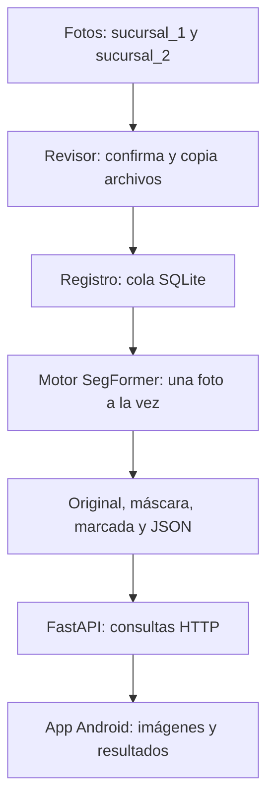

# StockEye: backend local en Python

Este proyecto se abre en **Visual Studio Code** y se ejecuta en el PC. Lee fotografías desde dos carpetas, identifica su sucursal, las analiza con un modelo SegFormer y publica los resultados para la aplicación Android.

La aplicación móvil está en [StockEye](../StockEye/README.md). El APK contiene el cliente Android; el modelo, la cola y el procesamiento permanecen en el PC. Visual Studio Code es el editor: el servidor que atiende las solicitudes es Uvicorn y la API está construida con FastAPI.

## 1. Cómo funciona el recorrido completo



1. `Revisor.revisar()` busca imágenes en las dos carpetas. Confirma que tamaño y fecha de modificación permanezcan estables entre revisiones.
2. El revisor copia cada entrada y calcula su SHA-256, una huella para identificar el contenido.
3. `Registro.encolar()` guarda el trabajo en SQLite. La combinación de sucursal, nombre relativo y contenido evita registrar otra vez la misma captura.
4. `Servicio.procesar_uno()` toma el siguiente trabajo pendiente y llama al motor.
5. El motor identifica fondo, ocupado y vacío, calcula las medidas y devuelve una `Prediccion`.
6. `Archivos.guardar()` conserva las imágenes y el JSON.
7. Android consulta los resultados guardados mediante la API. Las consultas GET no vuelven a analizar la foto.

**JSON** es un archivo de texto estructurado con campos y valores. **SQLite** es la base de datos local de la cola; no requiere instalar un servidor de base de datos aparte.

La revisión ocurre cada **30 segundos** por defecto. La primera incorporación suele producirse en la segunda revisión; luego cada imagen espera su turno. El procesador toma la siguiente al terminar la anterior, sin esperar otros 30 segundos.

## 2. Qué contiene cada carpeta

| Ruta | Para qué sirve |
|---|---|
| [stockeye/](stockeye/) | Código que ejecuta el backend. |
| [entradas/sucursal_1/](entradas/sucursal_1/) | Fotografías de Sucursal 1. |
| [entradas/sucursal_2/](entradas/sucursal_2/) | Fotografías de Sucursal 2. |
| [modelos/](modelos/) | Modelo compatible utilizado por el motor. La configuración apunta a `modelo.pt`. |
| `datos/` | Base de datos, bloqueo de instancia, copias pendientes y resultados. Su ubicación se configura. |
| [tests/](tests/) | Pruebas de cola, API, modelo y proceso completo. |
| [docs/](docs/) | Contrato del modelo e informes de validación. |
| `stockeye_v5/`, `stockeye_v6/` | Notebooks, experimentos, conjuntos de datos y artefactos del trabajo del modelo. El servicio utiliza el `.pt` configurado; no ejecuta esos notebooks al arrancar. |
| `.venv/` | Entorno Python local y sus dependencias. Se reconstruye al instalar el proyecto en otro equipo. |
| `__pycache__/` | Archivos generados por Python; no son el código fuente. |

Se aceptan imágenes estáticas JPG, JPEG, PNG, WEBP, BMP y TIFF. Las carpetas de entrada son planas: no se recorren subcarpetas ni enlaces simbólicos. Los archivos deben estar disponibles localmente si se utiliza OneDrive.

## 3. Archivos principales y responsabilidades

| Archivo | Qué hace y qué partes conviene leer |
|---|---|
| [iniciar.py](iniciar.py) | Punto de entrada. `main()` lee los argumentos, carga la configuración y ejecuta Uvicorn. `--comprobar-modelo` comprueba el `.pt` sin iniciar el servidor ni el revisor. |
| [config.json](config.json) | Define las dos entradas, almacenamiento, modelo, revisión, límites y dirección del servidor. |
| [stockeye/configuracion.py](stockeye/configuracion.py) | Los modelos `Modelo`, `Limites`, `API` y `Configuracion` validan los valores. `cargar_configuracion()` resuelve las rutas relativas respecto de `config.json`. `crear_carpetas()` prepara los directorios necesarios. |
| [stockeye/procesador.py](stockeye/procesador.py) | `Revisor` detecta y copia entradas estables. `Servicio` coordina la cola, carga el motor, procesa trabajos y controla los dos hilos: revisión e inferencia. |
| [stockeye/registro.py](stockeye/registro.py) | `Registro` maneja SQLite. `estable()` registra observaciones; `encolar()` agrega trabajos; `tomar()` toma el pendiente más antiguo; `terminar()` registra éxito o error; `listar()` permite consultar y paginar. |
| [stockeye/motor.py](stockeye/motor.py) | `MotorSegFormer` valida y carga el checkpoint, selecciona CPU/CUDA y ejecuta `inferir()`. `validar_imagen()` revisa formato, tamaño y píxeles. `Prediccion` agrupa el resultado que recibirá el guardado. |
| [stockeye/inferencia_base/__init__.py](stockeye/inferencia_base/__init__.py) | Código matemático de inferencia: configuración, normalización, segmentación, mosaicos/TTA, geometría de góndolas, repisas, porcentajes y semáforos. El motor utiliza estas funciones. |
| [stockeye/archivos.py](stockeye/archivos.py) | `Archivos` guarda resultados de forma atómica, genera la imagen amarilla, comprueba archivos y recupera análisis ya guardados después de una interrupción. |
| [stockeye/api.py](stockeye/api.py) | `crear_app()` construye FastAPI. Sus rutas entregan salud, trabajos, listas, análisis y archivos a Android. Valida que los resultados pertenezcan al trabajo registrado. |
| [stockeye/instancia.py](stockeye/instancia.py) | `InstanciaUnica` utiliza un bloqueo del sistema operativo para impedir dos procesadores sobre la misma carpeta de datos. |
| [stockeye/__init__.py](stockeye/__init__.py) | Identifica el paquete Python. |
| [gestionar.py](gestionar.py) | Consulta conteos o devuelve trabajos con error a la cola. Se utiliza con el backend detenido. |
| [preparar_modelo.py](preparar_modelo.py) | Convierte un checkpoint compatible en un `.pt` autocontenido. Conserva arquitectura y modo/umbral, comprueba tensores y no sobrescribe una salida existente. |
| [requirements.txt](requirements.txt) | Dependencias para ejecutar el servicio. |
| [requirements-dev.txt](requirements-dev.txt) | Dependencias adicionales para ejecutar las pruebas. |
| [.gitignore](.gitignore) | Indica qué archivos generados o locales se excluyen de Git. |
| [MANIFIESTO_SHA256.txt](MANIFIESTO_SHA256.txt) | Huellas de archivos de la entrega original. Las huellas dejan de coincidir con archivos modificados posteriormente; no es un historial de cambios. La entrada del README corresponde a su versión anterior. |

Para leer el código en orden: `iniciar.py` → `configuracion.py` → `procesador.py` → `registro.py` y `motor.py` → `archivos.py` → `api.py`.

### Qué biblioteca hace cada tarea

| Biblioteca | Uso |
|---|---|
| FastAPI y Pydantic | Definen la API y validan configuración y respuestas. |
| Uvicorn | Mantiene el servidor HTTP funcionando para atender a Android. |
| PyTorch, Transformers y Safetensors | Carga y ejecución del modelo compatible. |
| NumPy, Pillow y OpenCV | Lectura y transformación de imágenes, máscaras y cálculos. |
| psutil | Consulta del consumo de memoria del proceso. |
| `sqlite3` de Python | Cola persistente de trabajos. |
| pytest y httpx | Pruebas automatizadas; son herramientas de desarrollo. |

## 4. Configuración

En [config.json](config.json):

| Campo | Significado |
|---|---|
| `carpetas` | Debe contener exactamente las sucursales `1` y `2`, con carpetas diferentes que no se contengan entre sí. |
| `datos` | Almacena la cola y resultados. Debe estar separado de las entradas. |
| `modelo.archivo` | Ruta al `.pt` compatible. Debe estar fuera de las entradas. |
| `modelo.arquitectura_json` | Arquitectura auxiliar si el checkpoint no la incluye. El `.pt` preparado contiene su configuración. |
| `modelo.modo`, `modelo.umbral_vacio` | Si son `null`, se leen del `.pt`. Deben corresponder a valores validados durante el trabajo del modelo. |
| `modelo.dispositivo` | `auto`, `cpu` o `cuda`. `auto` selecciona CUDA cuando PyTorch detecta una GPU compatible. |
| `revision_segundos` | Intervalo entre revisiones; predeterminado: 30. |
| `estabilidad_segundos` | Tiempo mínimo sin cambios requerido al volver a observar un archivo. |
| `api.host`, `api.puerto` | Interfaz y puerto donde escucha el backend. |

Ejemplo del bloque de entradas dentro del JSON:

```json
"carpetas": {
  "1": "entradas/sucursal_1",
  "2": "entradas/sucursal_2"
}
```

Las rutas relativas se resuelven respecto del archivo de configuración, aunque ejecutes Python desde otra carpeta. También puedes usar rutas absolutas con `/` o escapar `\\` en JSON.

Los límites iniciales son 20 MB por archivo, 20 millones de píxeles, 4 GiB de RAM del proceso, 2 GiB de memoria CUDA asignada, 120 segundos de inferencia y dos hilos CPU. Son configurables y deben medirse en el equipo utilizado.

Las comprobaciones de tiempo y memoria ocurren entre operaciones: no interrumpen por la fuerza una llamada nativa de PyTorch. El tiempo de inferencia no incluye espera en cola ni escritura del resultado.

Conserva `datos/cola.sqlite3`, las copias pendientes y sus resultados juntos. Evita sincronizar o editar concurrentemente esos archivos mientras el backend los utiliza. En esta copia, la carpeta está dentro de OneDrive; comprueba su disponibilidad local y el comportamiento de sincronización antes de usarla de forma continuada.

## 5. Preparar el entorno, iniciar y detener

Abre una terminal PowerShell:

```powershell
cd "C:\Users\janto\OneDrive\Desktop\duoc\StockEye_backend_local"
```

El entorno utilizado en este equipo es Python 3.12 de 64 bits. Si `.venv` y sus dependencias ya están instalados, pasa directamente a comprobar el modelo. Para una instalación nueva:

```powershell
py -3.12 -m venv .venv
.\.venv\Scripts\python.exe -m pip install --upgrade pip
.\.venv\Scripts\python.exe -m pip install -r requirements.txt
```

PyTorch debe ser compatible con el equipo; CPU funciona sin GPU NVIDIA. La selección de una instalación CUDA requiere revisar la versión y el hardware.

En esta copia local existe `modelos/modelo.pt`. La existencia del archivo no demuestra que cargue correctamente ni certifica su precisión. Para comprobar su compatibilidad técnica:

```powershell
.\.venv\Scripts\python.exe iniciar.py --comprobar-modelo
```

Este comando carga el modelo para comprobarlo, pero no inicia la API ni procesa las carpetas de entrada.

Cuando corresponda poner en marcha el servicio:

```powershell
.\.venv\Scripts\python.exe iniciar.py
```

Mantén la terminal abierta. Para detenerlo, presiona **Ctrl+C**; el cierre espera la fotografía en curso antes de liberar la cola. Cerrar la app Android no detiene Python.

Puedes comprobar la API en:

- Estado: <http://127.0.0.1:8000/health>
- Documentación interactiva: <http://127.0.0.1:8000/docs>

Que `/health` responda no significa necesariamente que el modelo esté listo. Revisa `modelo.disponible`, `modelo.cargando` y `modelo.error`.

## 6. Modelo y resultados

El `.pt` debe cumplir el [contrato del modelo](docs/CONTRATO_MODELO.md): SegFormer StockEye v6, arquitectura, pesos, clases y configuración compatibles. Renombrar un modelo de otra familia no lo convierte en compatible.

Para preparar otra entrega, utiliza los valores de modo y umbral realmente validados:

```powershell
.\.venv\Scripts\python.exe preparar_modelo.py --checkpoint "ruta\best.pt" --modo "mosaicos+tta" --umbral 0.5 --salida modelos\modelo_nuevo.pt
```

Los valores anteriores son un ejemplo. La preparación comprueba formato y tensores; no evalúa la calidad predictiva. También admite el checkpoint de un bundle compatible junto con su manifiesto y arquitectura. La preparación no entrena el modelo.

Como alternativa, un `best.pt` compatible puede utilizarse directamente si contiene los datos requeridos y se completan `modelo.modo` y `modelo.umbral_vacio` cuando no estén incluidos. Consulta el contrato antes de sustituir la entrega preparada. El backend no descarga automáticamente una arquitectura de Hugging Face.

Para sustituir el modelo: detén el backend, conserva el anterior, configura o coloca el nuevo `.pt`, compruébalo y reinicia. El SHA-256 del archivo identifica la versión. Los resultados históricos conservan su versión; no se reanalizan automáticamente.

Cada análisis completado queda en `datos/resultados/<id>/`:

| Archivo | Contenido |
|---|---|
| `original.*` | Bytes de la fotografía de entrada. |
| `mascara.png` | Clases `0=fondo`, `1=ocupado`, `2=vacío`. |
| `superpuesta.jpg` | Original con vacíos resaltados en amarillo. |
| `resultado.json` | Sucursal, fecha, versión, tiempos, medidas, estados, dimensiones y archivos. |

El porcentaje de vacío se calcula por área respecto de ocupado y vacío. `null` en el porcentaje completo significa **no estimable**. `parcial`, `revisar` y `sin_gondola` no equivalen a una góndola llena. Las regiones vacías no son un conteo de productos faltantes.

## 7. API y conexión con Android

| Consulta GET | Devuelve |
|---|---|
| `/health` | Salud del servicio, modelo y conteos de cola. |
| `/api/imagenes?sucursal_id=1` | Imágenes completadas de una sucursal. |
| `/api/analisis/{id}` | Análisis y enlaces a sus archivos. |
| `/api/imagenes/{id}/archivo` | JPEG marcado. |
| `/api/imagenes/{id}/original` | Fotografía original. |
| `/api/imagenes/{id}/mascara` | Máscara PNG. |
| `/api/trabajos?estado=error` | Trabajos y errores; admite también `sucursal_id`. |

Las listas admiten `limite` y `desde`; `/api/imagenes` informa el total mediante `X-Total-Count`. El máximo de `limite` es 500. La lista de imágenes contiene `id`, `nombre`, `sucursal_id`, `sucursal`, `imagenUrl`, `actualizadaEn` y `estado_medicion`. Las URLs de archivos se resuelven contra la dirección del backend.

No hay endpoints POST para subir fotos, iniciar análisis o reencolar desde el móvil. Las entradas llegan por las carpetas del PC. Si un resultado registrado está dañado o falta, la API devuelve un error; no fabrica porcentajes.

| Cliente | Dirección que utiliza |
|---|---|
| Navegador del PC | `http://127.0.0.1:8000/` |
| Emulador Android Studio | `http://10.0.2.2:8000/` |
| Teléfono físico | `http://IP_LOCAL_DEL_PC:8000/` |

Para el teléfono físico, sustituye el bloque `api` dentro de `config.json`:

```json
"api": {
  "host": "0.0.0.0",
  "puerto": 8000
}
```

Reinicia el backend y utiliza en Android la IPv4 del PC obtenida con `ipconfig`. `0.0.0.0` es una dirección de escucha, no la dirección que se escribe en la app. Ambos equipos necesitan una red que permita comunicarse; permite la conexión de Windows en la red privada si se solicita.

La API local funciona sin autenticación y está planteada para una red de prueba. El APK `debug` permite HTTP; la variante Android `release` requiere HTTPS. Para instalar y utilizar el cliente, sigue el [README de Android](../StockEye/README.md).

## 8. Cola, errores y recuperación

Los estados del trabajo son `pendiente`, `procesando`, `completada` y `error`. El estado de medición del JSON es otra cosa: un trabajo puede completarse y tener una medición parcial.

Si el modelo falla al cargar, la API continúa disponible y conserva pendientes. Si falla una foto, se registra su error y se continúa con la siguiente. Una nueva versión del contenido en la misma ruta se considera otra captura; utiliza nombres únicos para conservar el historial de entradas.

Con el backend detenido:

```powershell
.\.venv\Scripts\python.exe gestionar.py estado
.\.venv\Scripts\python.exe gestionar.py reintentar-errores
```

Primero corrige la causa del error. Solo se reencolan trabajos que tengan una copia registrada. Un archivo rechazado por tamaño debe corregirse en su entrada. No borres SQLite para actualizar un modelo: perderías el historial.

Después de una interrupción, los trabajos que estaban procesándose vuelven a pendiente. Si sus resultados ya se guardaron completos, se verifica su integridad para recuperarlos sin repetir la inferencia.

## 9. Pruebas y alcance de la validación

| Archivo | Qué comprueba |
|---|---|
| [tests/conftest.py](tests/conftest.py) | Configuraciones, imágenes y motor controlado de prueba. |
| [tests/test_cola.py](tests/test_cola.py) | Detección, cola, persistencia y recuperación. |
| [tests/test_api.py](tests/test_api.py) | Consultas, filtros, paginación, archivos y errores. |
| [tests/test_modelo.py](tests/test_modelo.py) | Formato, carga y límites con modelos de prueba. |
| [tests/test_proceso_real.py](tests/test_proceso_real.py) | Servidor en otro proceso y recorrido HTTP con un modelo controlado. |

Para instalar las herramientas de prueba y ejecutar la suite:

```powershell
.\.venv\Scripts\python.exe -m pip install -r requirements-dev.txt
.\.venv\Scripts\python.exe -m pytest -q
```

La suite completa incluye procesos de prueba y carga de un modelo controlado. Para comprobar las consultas de API en memoria, excluyendo las pruebas que arrancan hilos de procesamiento:

```powershell
.\.venv\Scripts\python.exe -m pytest tests/test_api.py -q -k "not api_sigue_respondiendo_durante_inferencia and not arranca_sin_pt"
```

Durante la integración se ejecutó esa selección de 12 pruebas de API y terminó correctamente. Se utilizaron dependencias de pruebas aisladas en `../.stockeye-build/python-test-deps`; el comando estándar anterior requiere instalar `requirements-dev.txt` en el entorno utilizado.

El informe [docs/VALIDACION.md](docs/VALIDACION.md) y su [JSON](docs/VALIDACION.json) documentan pruebas de una entrega anterior. Sus resultados no certifican el modelo entrenado actual ni una conexión real con un teléfono. La carga del `.pt`, la precisión y el consumo deben comprobarse con los datos y el PC utilizados.

## 10. Dónde cambiar algo y cómo resolver fallos

| Quiero cambiar… | Archivo |
|---|---|
| Carpetas, puerto, intervalo o límites | `config.json` |
| Validación de la configuración | `stockeye/configuracion.py` |
| Detección y orden de procesamiento | `stockeye/procesador.py` |
| Persistencia, duplicados o consultas de trabajos | `stockeye/registro.py` |
| Carga de pesos y adaptación del modelo | `stockeye/motor.py` |
| Cálculo de segmentación, geometría y medidas | `stockeye/inferencia_base/__init__.py` |
| Nombres, contenido o guardado de resultados | `stockeye/archivos.py` |
| Endpoints o campos para Android | `stockeye/api.py` y el cliente `StockEyeApi.kt` en Android |

| Síntoma | Qué revisar |
|---|---|
| No se puede conectar | Terminal de Python abierta, puerto y dirección correctos. |
| Modelo no disponible | Mensaje de `/health` y `--comprobar-modelo`. |
| Una foto no aparece | Sucursal, extensión, archivo disponible localmente y espera entre revisiones. |
| Hay trabajos pero no resultados | Estado de la cola, carga del modelo y error de cada trabajo. |
| Otra instancia usa los datos | Cierra la instancia anterior; no elimines el bloqueo mientras siga funcionando. |
| Teléfono no conecta y el emulador sí | `api.host`, IP del PC, comunicación en la misma red y permiso de Windows. |
| Archivo o JSON de resultado no disponible | Integridad y disponibilidad de `datos/resultados`; conserva el historial antes de reparar. |

Los comandos de este README son instrucciones para cuando decidas ejecutarlos; editar esta documentación no inicia el servidor ni el modelo.
