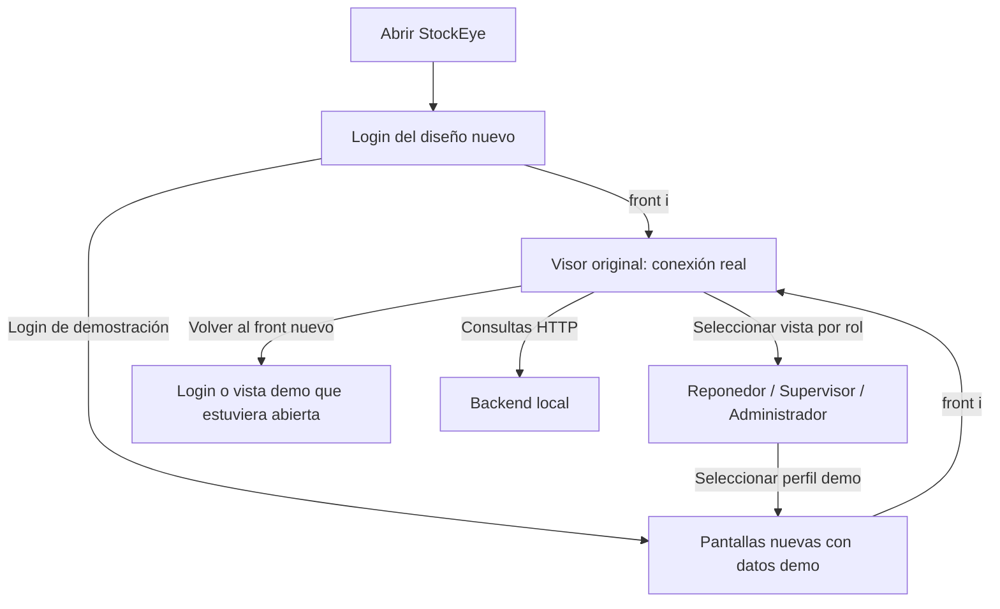
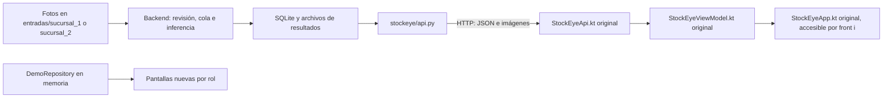

# Registro de cambios e integración de StockEye

**Fecha del registro:** 7 de noviembre de 2026.  
**Integración documentada:** incorporación del nuevo diseño Android al proyecto StockEye, conservando el visor original conectado al backend local.  
**Estado:** un APK con dos interfaces; la conexión real continúa en **front i** y las pantallas nuevas por rol mantienen datos de demostración.

Este documento explica qué se hizo, por qué se eligió esa estructura, qué archivos participan y cómo comprobar o recuperar el trabajo. Se elaboró revisando el código actual, el respaldo previo y los informes de pruebas disponibles. La fecha de este registro no significa que se hayan vuelto a ejecutar esas pruebas.

## 1. Alcance acordado

La aplicación debía abrir con el login del nuevo diseño y permitir entrar al visor original mediante el botón **front i**. Desde el visor original se debía poder elegir una vista de **Reponedor**, **Supervisor** o **Administrador**, sin esperar a que estuvieran terminados los usuarios y permisos del backend.

Se conservaron las consultas reales de fotografías, análisis y trabajos. Los campos del nuevo diseño que todavía no tienen un equivalente definido en el backend permanecieron en demostración. No se inventaron datos para completar esa conexión.

El resultado permite recorrer los dos diseños dentro de una aplicación. **Las pantallas nuevas todavía no consumen directamente la API real:** el acceso a los resultados reales se realiza abriendo el visor original.

## 2. Proyectos y responsabilidades

Las rutas de esta tabla son relativas a la carpeta `duoc`.

| Carpeta | Responsabilidad en la integración |
|---|---|
| [StockEye](../../StockEye/README.md) | Proyecto Android principal. Contiene ambos diseños y genera el APK integrado. Es la carpeta que se abre en Android Studio. |
| `StockEye-app-movil/app-movil` | Proyecto recibido con el diseño nuevo. Se utilizó como origen de sus pantallas, modelos y repositorio de demostración; esa carpeta se conservó como referencia. |
| [StockEye_backend_local](../README.md) | Servidor Python/FastAPI que procesa fotografías y entrega resultados mediante HTTP. La incorporación del nuevo diseño no requirió modificar su lógica. |
| `Respaldos/StockEye-antes-nuevo-front-2026-11-06` | Copia del proyecto Android anterior a la integración, para poder recuperar el estado previo. |

El modelo, la cola SQLite y los archivos de resultados permanecen en el PC. El APK contiene la aplicación cliente, no una copia del servidor ni del modelo.

## 3. Respaldo previo

Antes de incorporar el nuevo diseño se guardó una copia completa del proyecto Android en:

```text
duoc/
└── Respaldos/
    ├── StockEye-antes-nuevo-front-2026-11-06/
    └── StockEye-antes-nuevo-front-2026-11-06.manifest.json
```

El manifiesto registra **739 archivos**, sus rutas relativas, tamaños y huellas SHA-256. Quedó marcado con `Verified: true` después de verificar la copia y comprobar que los archivos de origen no hubieran cambiado durante ella.

El respaldo incluye archivos ocultos y archivos generados existentes en ese momento. Su contenido corresponde al proyecto Android; no es una copia del backend, de sus fotografías o de su base de datos.

Para elaborar este registro se volvió a comprobar que los siguientes tres archivos actuales coinciden por SHA-256 con sus versiones del respaldo:

- `app/src/main/java/com/example/myapplication/ui/StockEyeApp.kt`.
- `app/src/main/java/com/example/myapplication/ui/StockEyeViewModel.kt`.
- `app/src/main/java/com/example/myapplication/data/StockEyeApi.kt`.

Esto confirma que la pantalla, la coordinación y el cliente HTTP originales se conservaron durante esta integración. No representa una nueva verificación completa de los 739 archivos del respaldo.

## 4. Cómo se hizo la integración

### Paso 1: mantener StockEye como proyecto principal

Se incorporó el diseño recibido dentro de `StockEye`. Se mantuvieron su configuración de compilación, su actividad Android y el identificador `com.example.myapplication`.

No se sustituyó el proyecto principal por el Gradle ni por la `MainActivity` del proyecto recibido. Así se conservaron la conexión existente, los permisos y la configuración de red ya utilizados por el visor original.

### Paso 2: incorporar las fuentes nuevas con su propio paquete

Se copiaron 13 archivos Kotlin del nuevo diseño bajo:

```text
StockEye/app/src/main/java/cl/duoc/stockeye/
├── data/
│   ├── DemoRepository.kt
│   ├── Modelos.kt
│   └── StockEyeRepository.kt
└── ui/
    ├── StockEyeApp.kt
    ├── StockEyeViewModel.kt
    ├── components/Componentes.kt
    ├── screens/
    │   ├── AlertasScreen.kt
    │   ├── DetalleGondolaScreen.kt
    │   ├── LoginScreen.kt
    │   ├── MapaScreen.kt
    │   ├── PerfilScreen.kt
    │   └── ResumenScreen.kt
    └── theme/Theme.kt
```

De estos 13 archivos, 11 coinciden por SHA-256 con el proyecto recibido. Las dos adaptaciones corresponden al login y al ViewModel, descritas en los pasos siguientes.

El código original sigue bajo `com.example.myapplication` y el incorporado mantiene `cl.duoc.stockeye`. Ambos tienen clases llamadas `StockEyeApp` y `StockEyeViewModel`; los paquetes y los alias de importación permiten distinguirlas.

### Paso 3: adaptar los recursos del login

En la copia de `LoginScreen.kt` se cambió la referencia a `R` para utilizar los recursos del proyecto principal: `com.example.myapplication.R`.

El dibujo utilizado por el nuevo login se añadió como:

```text
app/src/main/res/drawable/stockeye_brand_foreground.xml
```

El login apunta a ese nombre de recurso. Se evitó reemplazar el icono original del proyecto solo para mostrar la marca dentro de la nueva pantalla.

### Paso 4: crear un contenedor para ambos diseños

Se añadió [StockEyeRoot.kt](../../StockEye/app/src/main/java/com/example/myapplication/ui/StockEyeRoot.kt). Este composable decide qué interfaz se muestra y proporciona los controles para cambiar entre ellas.

Sus responsabilidades son:

- Mostrar primero el diseño nuevo.
- Abrir la pantalla original al pulsar **front i**.
- Ofrecer **Volver al front nuevo** y **Seleccionar vista por rol** desde la pantalla original.
- Mostrar el selector de roles.
- Mantener visible la identificación de los datos de demostración.
- Aplicar el tema correspondiente a cada diseño.

Se modificó [MainActivity.kt](../../StockEye/app/src/main/java/com/example/myapplication/MainActivity.kt) para que `setContent` muestre `StockEyeRoot()`.

El contenedor usa dos ViewModels distintos, identificados por las claves `original-front` y `new-front`. La URL del backend, los resultados reales y el estado del visor original no se convierten en el estado del repositorio demo al cambiar de pantalla.

### Paso 5: permitir la entrada a las vistas por rol

En la copia del nuevo ViewModel se añadió `mostrarVistaPorRol(rol, onReady)`.

Este método carga los datos de `DemoRepository`, busca el primer perfil de demostración que corresponda al rol y lo selecciona. Cuando termina, el contenedor cierra el diálogo y muestra la interfaz nueva después de su login.

Mientras carga, los botones de selección quedan deshabilitados. Si no encuentra un perfil o sucede un error, se informa del problema sin completar la navegación.

**Elegir Administrador cambia la vista de demostración; no concede permisos en el servidor ni en Windows.** La validación de usuarios del login nuevo también pertenece al repositorio de demostración.

### Paso 6: añadir la dependencia de iconos

Se añadió el alias `androidx-material-icons-core` en `gradle/libs.versions.toml` y su uso mediante `implementation(libs.androidx.material.icons.core)` en `app/build.gradle.kts`.

Esta biblioteca proporciona los iconos usados por el diseño incorporado. La configuración principal del proyecto y su identificador de aplicación se conservaron.

### Paso 7: documentar y comprobar la compilación

Se amplió el README de Android con el flujo de ambas interfaces y sus límites. También se añadió `DualFrontNavigationTest.kt` para comprobar la navegación en un dispositivo cuando se ejecuten esas pruebas.

Se ejecutaron las pruebas unitarias y se generaron los APK de la aplicación y de las pruebas instrumentadas. Los resultados y sus límites se detallan en la sección 9.

## 5. Registro de archivos

Todas las rutas de esta tabla son relativas a `StockEye`. “Modificado” se refiere al estado anterior guardado en el respaldo; las adaptaciones de las fuentes recibidas se indican por separado.

| Archivo o conjunto | Cambio | Motivo |
|---|---|---|
| `app/src/main/java/com/example/myapplication/MainActivity.kt` | Modificado | Mostrar el contenedor `StockEyeRoot` como entrada de la app. |
| `app/src/main/java/com/example/myapplication/ui/StockEyeRoot.kt` | Añadido | Coordinar ambos diseños, los botones de regreso y el selector de roles. |
| `app/src/main/java/cl/duoc/stockeye/` | Añadido, 13 archivos Kotlin | Incorporar el nuevo diseño sin reemplazar las fuentes originales. |
| `cl/duoc/stockeye/ui/StockEyeViewModel.kt`, dentro de las fuentes anteriores | Adaptado respecto a la copia recibida | Añadir `mostrarVistaPorRol` para abrir perfiles demo. |
| `cl/duoc/stockeye/ui/screens/LoginScreen.kt`, dentro de las fuentes anteriores | Adaptado respecto a la copia recibida | Usar `R` del proyecto principal y el recurso de marca copiado. |
| `app/src/main/res/drawable/stockeye_brand_foreground.xml` | Añadido | Recurso gráfico del login nuevo. |
| `gradle/libs.versions.toml` | Modificado | Declarar la biblioteca de iconos. |
| `app/build.gradle.kts` | Modificado | Incluir esa dependencia en la app. |
| `app/src/androidTest/java/com/example/myapplication/DualFrontNavigationTest.kt` | Añadido | Cuatro casos de navegación entre interfaces y selección de roles. |
| `README.md` | Modificado | Explicar cómo abrir, compilar y utilizar el proyecto integrado. |

La pantalla, el ViewModel y el cliente HTTP originales listados en la sección 3 no cambiaron respecto al respaldo. La integración del nuevo diseño tampoco añadió endpoints al backend.

## 6. Recorrido de la aplicación



El botón **Volver al front nuevo** no cierra necesariamente el perfil demo: vuelve a la vista nueva que conserve su ViewModel. El botón Atrás del contenedor también permite salir del visor original; las pantallas internas pueden gestionar primero su propio regreso.

En el diseño nuevo, Reponedor dispone de Alertas, Pasillos y Perfil; Supervisor y Administrador disponen de Resumen, Pasillos, Alertas y Perfil.

Los cambios del nuevo diseño se mantienen en el repositorio demo en memoria. No se guardan como usuarios, alertas, permisos o configuraciones del backend real.

## 7. Cómo continúa funcionando la conexión real

La incorporación del nuevo diseño reutiliza la comunicación que ya tenía el visor original:



### Responsabilidades de cada parte

| Parte | Qué hace |
|---|---|
| Backend | Detecta fotografías en sus carpetas, ejecuta el modelo, guarda resultados y responde las consultas. |
| `StockEyeApi.kt` original | Valida la dirección del servidor, realiza GET y convierte JSON e imágenes en datos utilizables por Android. |
| `StockEyeViewModel.kt` original | Coordina conexión, sucursal, pestaña, paginación, actualización y detalle de fotografías. |
| `StockEyeApp.kt` original | Muestra controles, resultados, imágenes, trabajos y errores reales. |
| `StockEyeRoot.kt` | Permite navegar hacia ese visor; no transforma los resultados reales en datos demo. |
| `DemoRepository` | Alimenta las pantallas nuevas con perfiles, góndolas, alertas y acciones de demostración. |

### Solicitudes utilizadas

| Acción en el visor original | Consulta HTTP |
|---|---|
| Comprobar el servidor | `GET /health`; se verifica `servicio = stockeye-backend-local`. |
| Listar fotografías completadas | `GET /api/imagenes?sucursal_id=1&limite=30&desde=0`. |
| Listar trabajos de procesamiento | `GET /api/trabajos?sucursal_id=1&limite=30&desde=0`. |
| Abrir el análisis de una fotografía | `GET /api/analisis/{id}`. |
| Ver la fotografía marcada | `GET /api/imagenes/{id}/archivo`. |
| Ver la fotografía original | `GET /api/imagenes/{id}/original`. |

La sucursal puede ser 1 o 2 y `desde` cambia al paginar. El backend también ofrece `/api/imagenes/{id}/mascara`, aunque el visor actual alterna entre original y marcada.

Estas consultas leen resultados guardados. Tocar una fotografía o actualizar la lista no solicita una nueva inferencia. Las nuevas fotografías entran por las carpetas del backend, no por una subida desde el teléfono.

### Direcciones y red

| Dispositivo que consulta | Dirección del backend |
|---|---|
| El mismo PC que ejecuta Python | `http://127.0.0.1:8000/`. |
| Emulador de Android Studio de ese PC | `http://10.0.2.2:8000/`. |
| Teléfono físico en la misma red | `http://IP_LOCAL_DEL_PC:8000/`. |

En la configuración revisada, el backend escucha en `127.0.0.1:8000`. Para un teléfono físico se necesita configurar la escucha del servidor en una interfaz accesible, por ejemplo `0.0.0.0`, y utilizar en el teléfono la IP real del PC. Ese cambio requiere reiniciar el backend y puede requerir una regla de firewall para la red privada; **no se realizó al crear este registro**.

La app declara permisos de Internet y de red local. El visor gestiona la solicitud de acceso local en las versiones Android que lo requieren. El APK `debug` permite HTTP; la configuración principal, utilizada por `release`, exige HTTPS.

El backend local actual no ofrece autenticación de usuarios. Si se habilita acceso desde la red, los equipos que puedan llegar al servicio podrán consultar los endpoints disponibles. HTTP no cifra el tráfico. El selector de roles de demostración no modifica esas condiciones ni protege la API.

## 8. Funcionalidades reales y funcionalidades demo

| Función | Estado después de la integración |
|---|---|
| Fotografías procesadas por sucursal | Real, dentro de **front i**. |
| Original, imagen marcada y análisis | Real, dentro de **front i**. |
| Pendientes, errores y trabajos de la cola | Real, dentro de **front i**. |
| Login del diseño nuevo | Validación local contra datos demo; no es autenticación del backend. |
| Elegir Reponedor, Supervisor o Administrador | Vista de demostración, accesible desde el selector. |
| Mapa, resumen, alertas y perfil del nuevo diseño | Datos de `DemoRepository`. |
| Asignar o resolver alertas y guardar umbrales del nuevo diseño | Cambios demo en memoria; no actualizan el backend. |
| Usuarios y permisos reales | Pendientes de implementación en el servidor y el cliente. |
| Subir fotografías desde el teléfono | No implementado en la aplicación actual. |
| Ver resultados reales directamente en las pantallas nuevas | Pendiente de definir el contrato y adaptar los datos disponibles. |

La propiedad `direccionBackend` del ViewModel nuevo todavía no se utiliza para consultar la red. Cambiarla no conecta sus pantallas con la API.

No se convirtió una medición de una fotografía en una entidad de góndola o repisa del diseño nuevo sin definir antes su relación. Tampoco se inventaron asignaciones, usuarios o ubicaciones.

## 9. Validación realizada y límites

### Evidencias de la integración del 6 de noviembre de 2026

Se ejecutaron estas tareas de Gradle:

```text
:app:testDebugUnitTest
:app:assembleDebug
:app:assembleDebugAndroidTest
```

| Comprobación | Resultado y alcance |
|---|---|
| `StockEyeApiTest` | 12 pruebas unitarias aprobadas; 0 fallos y 0 errores. Usan respuestas controladas en memoria. |
| `ExampleUnitTest` | 1 prueba básica aprobada. No valida por sí sola una función del negocio. |
| Compilación de la aplicación | APK `debug` generado correctamente. |
| Compilación de las pruebas instrumentadas | APK de pruebas generado correctamente; no equivale a ejecutarlas. |
| `DualFrontNavigationTest` | Cuatro casos escritos y compilados: inicio/regreso, Reponedor, Supervisor con regreso y Administrador. No ejecutados en un dispositivo por esta validación. |
| Archivos originales de conexión | Los tres archivos indicados en la sección 3 coinciden con el respaldo por SHA-256. |

El APK integrado quedó en:

```text
StockEye/app/build/outputs/apk/debug/app-debug.apk
```

Además, en una fase anterior de conexión se habían aprobado 12 pruebas seleccionadas de API del backend, con un motor controlado y sin abrir el servidor real. Ese resultado es un antecedente independiente de la compilación del nuevo diseño.

El informe [VALIDACION.md](VALIDACION.md) recoge otra validación anterior, realizada en Linux con modelos de prueba. Sus 39 pruebas no deben sumarse como si fueran pruebas nuevas del APK integrado.

### Lo que estas evidencias no certifican

Las pruebas unitarias y la compilación no demuestran por sí solas la navegación visual en un dispositivo, la conectividad del teléfono, los permisos de red, la compatibilidad del modelo entrenado real ni su precisión.

Durante la creación de este registro solo se leyeron archivos e informes y se añadió documentación. No se volvió a compilar, no se ejecutaron pruebas, no se instaló el APK y no se inició el backend, el emulador ni el modelo.

### Recorrido manual pendiente

Cuando se decida probar el sistema en funcionamiento, conviene revisar:

1. Que la app abra con el login nuevo y la identificación de demostración.
2. Que **front i** abra la conexión original.
3. Que la URL corresponda al dispositivo y el permiso de red esté concedido.
4. Que, con el backend iniciado por separado, puedan consultarse salud, sucursales, trabajos y una fotografía real disponible.
5. Que la fotografía marcada, la original y sus valores correspondan al mismo análisis.
6. Que el selector abra cada rol con la etiqueta de demostración visible.
7. Que se pueda regresar entre diseños sin perder la dirección del backend ni presentar datos demo como reales.

Estos pasos describen una comprobación futura; no son un registro de ejecución satisfactoria.

## 10. Condiciones para conectar los datos reales al nuevo diseño

Una fase posterior debe definir qué datos reales necesita cada pantalla y qué información proporciona hoy la API. Antes de implementar la adaptación se necesita acordar:

- Identificadores y relaciones entre fotografía, sucursal, góndola y repisa.
- Interpretación de `pct_vacio_observado`, `pct_vacio_gondola_completa`, `estado_medicion` y `semaforo`.
- Tratamiento de valores desconocidos, análisis parciales y fotografías sin detecciones.
- Persistencia y endpoints de usuarios, alertas, asignaciones y umbrales que se quieran utilizar.
- Autenticación y autorización verificadas por el backend para las operaciones que lo requieran.

Un porcentaje `null` debe conservarse como desconocido; no significa 0 % de vacío ni 100 % de ocupación. Las métricas, umbrales o semáforos demo no sustituyen los resultados del análisis real.

Según lo acordado, **si falta el dato o su significado todavía no está definido, su adaptación debe esperar**. La selección visual de un rol puede seguir sirviendo para revisar diseños, pero no debe transformarse en el mecanismo de seguridad de una versión con permisos reales.

## 11. Cómo volver al estado anterior

El respaldo permite recuperar el Android anterior a la incorporación del nuevo diseño. Para hacerlo con posibilidad de conservar también el trabajo actual:

1. Guardar los cambios que estén abiertos y conservar aparte una copia del proyecto integrado actual.
2. Copiar el respaldo a una carpeta distinta, sin sobrescribir automáticamente la carpeta actual.
3. Verificar la copia contra el manifiesto SHA-256 del respaldo.
4. Abrir esa copia desde Android Studio y revisar las rutas locales del SDK y del JDK.
5. Compilar y comprobar por separado la versión recuperada antes de sustituir una instalación utilizada.

La restauración se realiza sobre el proyecto Android. No implica restaurar ni borrar `datos`, `entradas` o `modelos` del backend. En este registro no se ejecutó ninguna restauración.

## 12. Referencias para continuar

- [README de Android](../../StockEye/README.md): funcionamiento, compilación, red y distribución del APK.
- [README del backend](../README.md): carpetas, configuración, modelo, API y operación.
- [Contenedor de ambos diseños](../../StockEye/app/src/main/java/com/example/myapplication/ui/StockEyeRoot.kt).
- [Cliente de la API real](../../StockEye/app/src/main/java/com/example/myapplication/data/StockEyeApi.kt).
- [ViewModel del diseño nuevo](../../StockEye/app/src/main/java/cl/duoc/stockeye/ui/StockEyeViewModel.kt).
- [Repositorio de demostración](../../StockEye/app/src/main/java/cl/duoc/stockeye/data/DemoRepository.kt).
- [Pruebas de navegación](../../StockEye/app/src/androidTest/java/com/example/myapplication/DualFrontNavigationTest.kt).
- [API del backend](../stockeye/api.py).
- [Contrato del modelo](CONTRATO_MODELO.md).

Para futuras entradas de este registro, indicar la fecha, el comportamiento que cambió, los archivos afectados, las pruebas realmente ejecutadas y los asuntos pendientes. Separar siempre los resultados reales de los datos de demostración.
